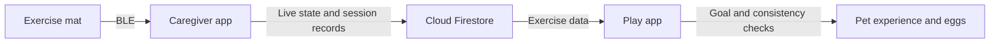

# IncreMat Play

A Flutter companion app that turns sit-to-stand exercise into a virtual-pet collection for older adults. Daily exercise goals contribute to pet growth, while consistent activity can unlock new eggs.

Developed as part of **IncreMat, RC4 STEER Shenzhen 2026**, alongside the [IncreMat Caregiver app](https://github.com/chuayawen/incremat).


*Pet artwork bundled with the app.*

**Start here:** [Flutter app and code tour](src/incremat_play/README.md) · [Setup instructions](SETUP.md) · [Caregiver app](https://github.com/chuayawen/incremat)

## What the Play app does

- **Pet progression:** hatch eggs, collect pets in a sanctuary, and grow them through baby, young, and adult stages.
- **Rewards for exercise:** daily goal completion can award pet experience, while meeting a weekly consistency threshold can award an egg.
- **Live progress and history:** read the caregiver app's shared exercise data and show current and completed activity.
- **Exercise together:** create or join a two-person Duet session with a shared progress display.
- **Simple account linking:** connect a senior profile through a join code or supported NFC login, using Firebase anonymous authentication behind the scenes.
- **Accessibility settings:** adjustable text size, high contrast, light/dark themes, and English/Chinese interfaces.

## How exercise becomes pet progress



In the public version in this repository, the Play app receives live exercise state through Firestore from the caregiver app. Its own NFC support is used for profile login. The caregiver app owns the BLE connection to the mat.

The reward logic records the last awarded day and week to guard against repeated awards when the same exercise data is processed again. See [`game_service.dart`](src/incremat_play/lib/services/game_service.dart) and [`consistency_service.dart`](src/incremat_play/lib/services/consistency_service.dart).

## Repository map

This repository contains **two independently built projects**. The Flutter app is nested because the repository began from an ESP32 course template.

| Location | Purpose |
| --- | --- |
| [`src/incremat_play/`](src/incremat_play/README.md) | The senior-facing Flutter app: screens, pet progression, shared exercise data, and app assets |
| [`src/main.cpp`](src/main.cpp) | Original ESP32 board diagnostics, clock, display, and connectivity starter code |
| [`platformio.ini`](platformio.ini) | PlatformIO configuration for the ESP32 starter |
| [`scripts/`](scripts/) | Build support for the firmware starter |
| [`SETUP.md`](SETUP.md) | Separate instructions for running the app and building the starter firmware |

The root ESP32 starter is retained as course-project context. It is not the complete pressure-sensing, NFC, and BLE exercise-mat firmware.

## Run the app

```bash
git clone https://github.com/chuayawen/incremat-play.git
cd incremat-play/src/incremat_play
flutter pub get
```

Configure an **Android Firebase development project** with Anonymous Authentication, Firestore, and a senior profile created through the caregiver workflow. Both apps must point to the same backend. Follow the [setup guide](SETUP.md#run-the-flutter-app) before running:

```bash
flutter run
```

The app requires Dart **3.12 or later within Dart 3**. Android is the documented target; the current entry point uses native Firebase configuration.

## Project status

The app is a **student prototype**. Its current widget test is a placeholder; it does not verify pet rewards, Firebase permissions, or the two-app exercise flow. Those paths require further automated coverage and device testing. The [app README](src/incremat_play/README.md#checks-and-current-test-coverage) points to the relevant implementation and checks.

## Credits

The repository started from [Sustainable Living Lab's UTC_2738_STEER template](https://github.com/SustainableLivingLab/UTC_2738_STEER). The original **MIT license and SL2 copyright notice** are retained in [LICENSE](LICENSE).
